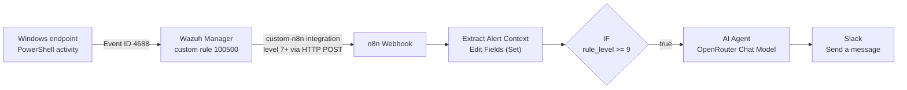

# AI-Assisted Security Alert Triage — Wazuh → n8n → AI Agent → Slack

## Overview

An automated SOC alerting pipeline built in a home lab. **Wazuh** detects suspicious activity on a Windows endpoint and forwards the alert to an **n8n** workflow through a webhook. An **AI Agent** (via **OpenRouter**) analyzes only the relevant alert context, and a concise, evidence-based security alert is posted to a **Slack** channel.

> 📄 Full step-by-step documentation with screenshots: [`AI-Assisted-Security-Alert-Triage.pdf`](./AI-Assisted-Security-Alert-Triage.pdf)
>
> Figure numbers mentioned in this README refer to that PDF.

---

## Architecture



> The IF threshold shown is the value recorded in the final documentation. It was originally `>= 10` and was lowered during troubleshooting. See [Troubleshooting → item 2](#troubleshooting).

## How it works

1. **Detect.** Windows records process creation (Event ID 4688), including the command line. A custom Wazuh rule fires when a command line contains `-EncodedCommand`.
2. **Forward.** A custom Wazuh integration (`custom-n8n`) sends every alert at level 7 or higher as JSON to the n8n production webhook.
3. **Reduce.** n8n extracts only the fields the AI needs instead of sending the full Wazuh alert.
4. **Filter.** An IF node passes only higher-severity alerts to the LLM, so not every event consumes AI credits.
5. **Analyze.** The AI Agent acts as a SOC analyst. It writes a short alert that separates observed evidence from analysis and decodes encoded commands when it reliably can.
6. **Notify.** The agent's response (`{{$json.output}}`) is posted to a Slack channel by a bot.

## Tech stack

| Component | Role |
|---|---|
| **Wazuh** | SIEM / XDR: log collection, detection rules, alert forwarding |
| **Windows 10** | Monitored endpoint (Wazuh agent) |
| **Kali Linux** | Admin machine used to SSH into the Wazuh server |
| **n8n (Cloud)** | Workflow automation: webhook, data shaping, filtering, routing |
| **OpenRouter** | Single API for multiple LLM providers. Model used: `deepseek/deepseek-v4-flash` |
| **AI Agent (n8n)** | Analyzes the alert context using the [prompt](#ai-agent-prompt) below |
| **Slack** | Alert delivery to the SOC channel via a bot app |

---

## Setup

### 1. Windows: enable process creation & command-line auditing

Run in PowerShell **as Administrator**:

```powershell
# Record process creation events
auditpol /set /subcategory:"Process Creation" /success:enable

# Include the command line in process creation events
reg add "HKLM\SOFTWARE\Microsoft\Windows\CurrentVersion\Policies\System\Audit" /v ProcessCreationIncludeCmdLine_Enabled /t REG_DWORD /d 1 /f

# Verify that Success auditing is enabled
auditpol /get /subcategory:"Process Creation"
```

### 2. Wazuh: custom detection rule

Edit `/var/ossec/etc/rules/local_rules.xml`:

```bash
sudo nano /var/ossec/etc/rules/local_rules.xml
```

Rule as captured from the Wazuh server (Figure 47):

```xml
<group name="n8n_test,">
    <rule id="100500" level="10">
        <if_sid>67027</if_sid>
        <field name="win.eventdata.commandLine">-EncodedCommand</field>
        <description>PowerShell EncodedCommand executed on Windows endpoint</description>
        <mitre>
            <id>T1059.001</id>
        </mitre>
        <group>windows,powershell,</group>
    </rule>
</group>
```

| Element | Meaning |
|---|---|
| `100500` | Custom rule ID |
| `level="10"` | Alert severity |
| `if_sid 67027` | Checks events matching the original Windows process creation rule |
| `commandLine` | Matches when the command line contains `-EncodedCommand` |
| `T1059.001` | MITRE ATT&CK technique ID attached to the alert |

> **Note on the rule level:** the documentation contains two versions of this rule. The server screenshot above (Figure 47) uses `level="10"` with the `<mitre>` block. The Slack alert in Figure 40 matches it (`Severity Level: 10`, `MITRE ATT&CK: T1059.001`). A second version in Figure 48 uses `level="12"` without `<mitre>`, and the `alerts.json` check in the documentation records `Severity: 12`.

### 3. Wazuh: custom n8n integration script

Create `/var/ossec/integrations/custom-n8n` on the Wazuh server:

```bash
sudo nano /var/ossec/integrations/custom-n8n
```

```python
#!/usr/bin/env python3

import sys
import json
import urllib.request

alert_file = sys.argv[1]
webhook_url = sys.argv[3]

with open(alert_file, "r") as f:
    alert = json.load(f)

payload = json.dumps(alert).encode("utf-8")

request = urllib.request.Request(
    webhook_url,
    data=payload,
    headers={"Content-Type": "application/json"},
    method="POST"
)

try:
    with urllib.request.urlopen(request, timeout=10) as response:
        print(response.read().decode())
except Exception as e:
    print(f"n8n integration error: {e}")
    sys.exit(1)
```

The script takes the alert file generated by Wazuh, reads it as JSON, and sends the same alert as an HTTP POST request to the n8n webhook.

Set permissions and ownership:

```bash
sudo chmod 750 /var/ossec/integrations/custom-n8n
sudo chown root:wazuh /var/ossec/integrations/custom-n8n
```

### 4. Wazuh: register the integration in `ossec.conf`

```bash
sudo nano /var/ossec/etc/ossec.conf
```

Add inside `<ossec_config>`:

```xml
<integration>
    <name>custom-n8n</name>
    <hook_url>https://<your-n8n-instance>/webhook/wazuh-alert</hook_url>
    <level>7</level>
    <alert_format>json</alert_format>
</integration>
```

`<level>7</level>` means every Wazuh alert at level 7 or higher is sent to n8n. This threshold is separate from the IF node threshold inside n8n.

Validate and restart:

```bash
sudo /var/ossec/bin/wazuh-analysisd -t
sudo systemctl restart wazuh-manager
sudo systemctl status wazuh-manager
```

### 5. n8n: workflow

| # | Node | Configuration |
|---|---|---|
| 1 | **Webhook** | Method `POST`, path `wazuh-alert`, Authentication `None` |
| 2 | **Extract Alert Context** (Edit Fields / Set) | Keeps only the key fields listed below |
| 3 | **IF** | `rule_level` → *is greater than or equal to* → `9` (final documented value; see note below) |
| 4 | **AI Agent** | Connected to the IF **true** output · Chat Model: **OpenRouter** (`deepseek/deepseek-v4-flash`) · Source for Prompt: *Define below* |
| 5 | **Slack: Send a message** | Resource `Message` · Operation `Send` · Send Message To `Channel` · Message Text `{{$json.output}}` |

> **IF node history.** The IF node screenshot taken during the build (Figure 10) shows the original condition:
> `{{ $('Webhook').item.json.body.rule.level }}` *is greater than or equal to* `10`.
> The threshold was lowered after a level-9 alert was blocked ([Troubleshooting → item 2](#troubleshooting)). The final documentation records the condition as `rule_level >= 9`. No screenshot of the updated IF node is included.

**Fields created by _Extract Alert Context_** (expressions as shown in Figures 6–8):

```text
rule_id            String   {{ $json.body.rule?.id ?? 'Not available' }}
rule_level         Number   {{ Number($json.body.rule?.level ?? 0) }}
description        String   {{ $json.body.rule?.description ?? 'Not available' }}
event_id           String   {{ $json.body.data?.win?.system?.eventID ?? 'Not available' }}
Provider           String   {{ $json.body.data?.win?.system?.providerName ?? 'Not available' }}
User               String   {{ $json.body.data?.win?.eventdata?.user ?? $json.body.data?.win?.eventdata?.targetUserName ?? 'Not available' }}
Process            String   {{ $json.body.data?.win?.eventdata?.image ?? 'Not available' }}
Command Line       String   {{ $json.body.data?.win?.eventdata?.commandLine ?? 'Not available' }}
Target File        String   {{ $json.body.data?.win?.eventdata?.targetFilename ?? 'Not available' }}
Process ID         String   {{ $json.body.data?.win?.eventdata?.processId ?? 'Not available' }}
Parent Process ID  String   {{ $json.body.data?.win?.eventdata?.parentProcessId ?? 'Not available' }}
Parent Process     String   {{ $json.body.data?.win?.eventdata?.parentImage ?? 'Not available' }}
Raw Message        String   {{ $json.body.full_log ?? $json.body.fullLog ?? $json.body.data?.sca?.description ?? 'Not available' }}
Hostname           String   {{ $json.body.agent?.name ?? $json.body.manager?.name ?? 'Not available' }}
MITRE Technique    String   {{ ($json.body.rule?.mitre?.id ?? []).join(', ') || 'Not available' }}
```

Sending only this context instead of the entire Wazuh alert reduces unnecessary data and keeps the AI focused on the security-relevant details. Missing values fall back to `Not available`, which matches the prompt rule that missing fields are normal.

**Test URL vs. Production URL**

- `…/webhook-test/wazuh-alert` is used while building. n8n listens only after you click *Listen for test event*.
- `…/webhook/wazuh-alert` is used by Wazuh once the workflow is **published/active**.

Quick test from Windows CMD while the webhook is listening:

```cmd
curl -X POST "https://<your-n8n-instance>/webhook-test/wazuh-alert" -H "Content-Type: application/json" -d "{\"rule\":{\"id\":\"100002\",\"level\":10,\"description\":\"Suspicious PowerShell activity\"},\"agent\":{\"name\":\"WIN11-LAB\"}}"
```

Expected response:

```json
{"message":"Workflow was started"}
```

### 6. Slack: bot app

1. Create the app with **Create App → Blank App**, name it `n8n-security-lab`, and select the `n8n-security-lab` workspace.
2. Under **Bot Token Scopes**, click **Add an OAuth Scope** and add `chat:write`, which lets the bot send messages.
3. Click **Install App → Install to n8n-security-lab → Allow** to get the **Bot User OAuth Token**.
4. Copy the **Signing Secret** from **Basic Information**.
5. In n8n, connect the Slack node with the token and the signing secret.
6. Create the channel `n8n-automation-security-2` and invite the bot:
   ```
   /invite @n8n-security-lab
   ```
7. In the Slack node **Options**, *Include Link to Workflow* is enabled. It adds the "Automated with this n8n workflow" link seen in the alerts. It is a convenience link and not required for the pipeline to work.

---

## AI Agent prompt

Configured in the AI Agent node under **Prompt (User Message)** with *Source for Prompt: Define below*.

```text
You are a SOC analyst.

Analyze this security alert:

Rule ID: {{$json.rule_id}} Rule Level: {{$json.rule_level}}
Description: {{$json.description}} Hostname: {{$json.body.data.win.system.computer}}
Event ID: {{$json.event_id}} Provider: {{$json.Provider}}
User: {{$json.User}} Process: {{$json.Process}}
Command Line: {{$json["Command Line"]}} Parent Process: {{$json["Parent Process"]}}
Target File: {{$json["Target File"]}} Process ID: {{$json["Process ID"]}}
Parent Process ID: {{$json["Parent Process ID"]}} MITRE Technique: {{$json["MITRE Technique"]}}
Raw Message: {{$json["Raw Message"]}}

Create a concise SOC alert for Slack.

Rules:
- Only use facts explicitly present in the provided alert fields.
- Do not invent MITRE ATT&CK techniques, Event IDs, processes, users, files, commands, or attacker behavior.
- Do not assume a specific Windows or Sysmon event type.
- Different events contain different fields; missing fields are normal.
- If a field is missing, do not infer its value.
- Clearly separate observed evidence from analysis.
- If the event only proves file creation, describe file creation.
- If it proves process execution, describe process execution.
- If intent cannot be determined from the evidence, say so.
- Do not recommend containment unless the evidence clearly justifies it.
- Do not assign or calculate severity. Severity is handled separately by Wazuh/n8n.
- Always include the observed command line if available.
- Do not paraphrase the observed command line.
- If the command contains encoded, obfuscated, or transformed content and you can reliably decode or interpret it, include the decoded/interpreted result.
- If you cannot reliably decode or interpret it, write "Not available".
- Keep the response concise.
- Use Slack-compatible mrkdwn.
- Do not use double asterisks.

Use exactly this structure:

🚨 *Security Alert*

*Host:* {{$json.body.data.win.system.computer}} *User:* {{$json.user}}
*Process:* {{$json.Process}} *Severity Level:* {{$json.rule_level}}

*What happened*
<1-2 concise sentences based only on observed evidence>

*Observed command*
<exact command line as provided, or "Not available">

*Decoded / interpreted content*
<decoded or interpreted content if reliably available, otherwise "Not available">

*Why it matters*
<1 concise analytical sentence>

*MITRE ATT&CK*
<technique ID and name, or "Not specified">

*Recommended action*
<1 concise investigation step>
```

> **About this transcription.** The exported PDF dropped the `$` from most expressions and rendered `*…*` as italics. The `$json` syntax and single-asterisk Slack bold markers are restored here based on three things:
> - the AI Agent screenshot (Figure 13) shows the literal `*Recommended action*`
> - the only expression that survived the export intact is `{{$json["Raw Message"]}}`
> - every other n8n expression in the screenshots uses `$json`

**Prompt references vs. Extract Alert Context output**

| Prompt reference | Status |
|---|---|
| `rule_id`, `rule_level`, `description`, `event_id`, `Provider`, `User`, `Process`, `Command Line`, `Parent Process`, `Target File`, `Process ID`, `Parent Process ID`, `MITRE Technique`, `Raw Message` | Match fields created by Extract Alert Context |
| `$json.body.data.win.system.computer` (Hostname / Host) | Not one of the extracted fields. Extract Alert Context defines a separate `Hostname` field (`body.agent.name`, falling back to `body.manager.name`). This path only resolves if the Set node also passes the original input fields through, and that setting is not visible in the screenshots. **Unverified.** |
| `$json.user` (lowercase, in the output template) | The extracted field is `User` (capital U). **Unverified.** The Slack alert (Figure 40) shows `User: Ibrahim`, but the evidence does not show whether that value came from this expression or from the model reading the `User:` line in the alert section. |

---

## Testing

Publish the workflow in n8n, then run this test script on the Windows endpoint (`Testscript.ps1`):

```powershell
$cmd = 'Write-Output "n8n-wazuh-test"'

$bytes = [System.Text.Encoding]::Unicode.GetBytes($cmd)

$encoded = [Convert]::ToBase64String($bytes)

powershell.exe -EncodedCommand $encoded
```

| Line | What it does |
|---|---|
| 1 | Stores the command `Write-Output "n8n-wazuh-test"` in `$cmd` |
| 2 | Converts it to bytes using Unicode encoding |
| 3 | Encodes the bytes as Base64 |
| 4 | Executes it with PowerShell's `-EncodedCommand` option |

Confirm the alert on the Wazuh server:

```bash
sudo tail -f /var/ossec/logs/alerts/alerts.json
sudo grep '"id":"100500"' /var/ossec/logs/alerts/alerts.json | tail -3
```

**Documented results**

- The `alerts.json` check recorded **Rule ID** `100500`, **Severity** `12`, and **Description** `PowerShell EncodedCommand executed on Windows endpoint`.
- The Slack alert in Figure 40 shows:
  - **Host** `Windows10`, **User** `Ibrahim`, **Process** `C:\Windows\System32\WindowsPowerShell\v1.0\powershell.exe`, **Severity Level** `10`
  - the observed `-EncodedCommand` command line
  - the decoded content `Write-Output "n8n-wazuh-test"`
  - **MITRE ATT&CK** `T1059.001`

The two severity values come from the two rule versions described in [Setup → 2](#2-wazuh-custom-detection-rule). Both values pass the IF node in either configuration, `>= 9` or `>= 10`, so this test does not distinguish between the two thresholds.

---

## Troubleshooting

<details>
<summary><strong>1. "Running scripts is disabled on this system" when running <code>Testscript.ps1</code></strong></summary>

Allow scripts for the current PowerShell session only:

```powershell
Set-ExecutionPolicy -Scope Process -ExecutionPolicy Bypass
```
</details>

<details>
<summary><strong>2. Alert reaches n8n but never reaches the AI Agent</strong></summary>

**Symptom:** a level-9 alert (Wazuh rule `19005`, an SCA summary) reached n8n but did not continue to the AI Agent.

**Cause:** two separate thresholds were in place:

```text
Wazuh integration:        <level>7</level>     → n8n receives alerts of level 7–15
n8n IF node (original):   rule.level >= 10     → 9 >= 10 = FALSE
```

Nothing was broken. The workflow did exactly what it was configured to do. The Wazuh `<level>` decides what reaches n8n, and the IF node decides what reaches the AI.

**Adjustment:** the troubleshooting analysis suggested aligning the IF node with the Wazuh threshold (`>= 7`). The final documentation records the IF node as `rule_level >= 9`, which lets level-9 alerts through. No screenshot of the updated IF node is included, so `>= 9` is the documented value but is not screenshot-verified.
</details>

<details>
<summary><strong>3. Wazuh doesn't detect PowerShell execution / command line is missing</strong></summary>

Windows was not recording process creation and command-line details. Enable them with the commands in [Setup → 1](#1-windows-enable-process-creation--command-line-auditing), then confirm that the resulting Event ID 4688 contains the full command line.
</details>

---

## Security notes

- **Never commit secrets.** The OpenRouter API key, Slack Bot User OAuth Token, and Slack Signing Secret belong in n8n credentials only. Replace real values with placeholders such as `<your-n8n-instance>` before publishing.
- **Rotate any credential that has been exposed** in screenshots, documents, or commit history.
- **Protect the production webhook.** The Webhook node uses *Authentication: None*, so anyone who knows the URL can post fake alerts and consume LLM credits. Consider enabling header authentication on the Webhook node.
- **Treat the AI output as an analyst aid, not a verdict.** The prompt forbids inventing facts and leaves severity to Wazuh.

## Repository contents

```text
.
├── README.md
└── AI-Assisted-Security-Alert-Triage.pdf
```
